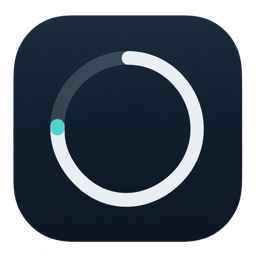
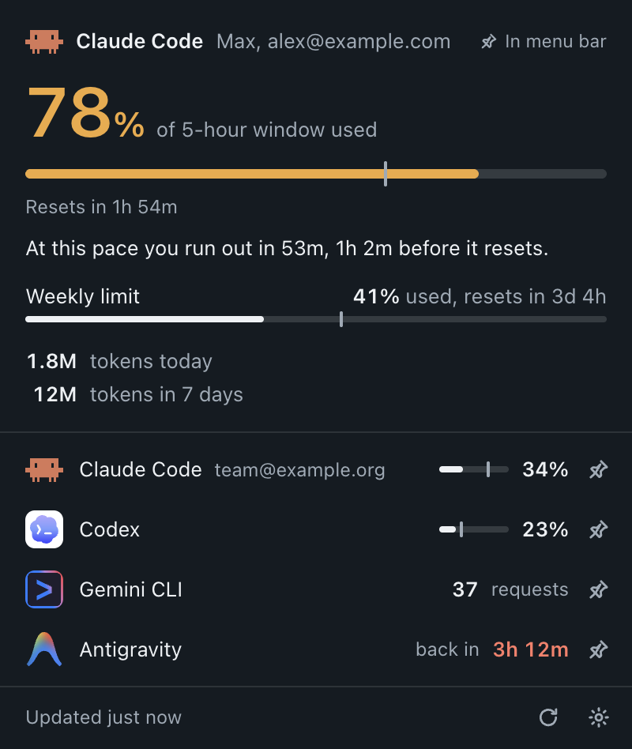
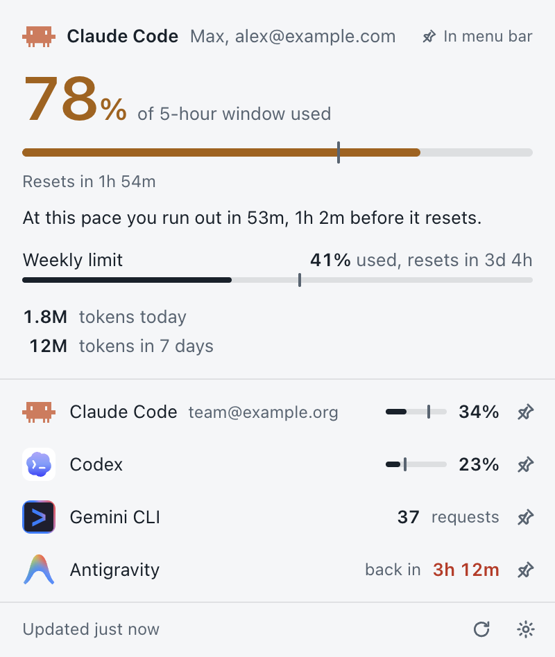
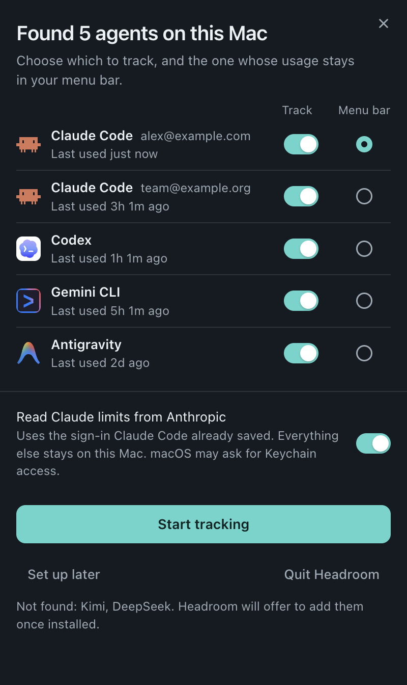
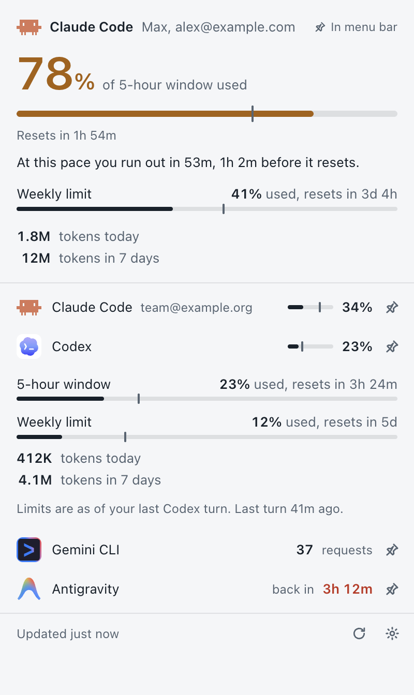
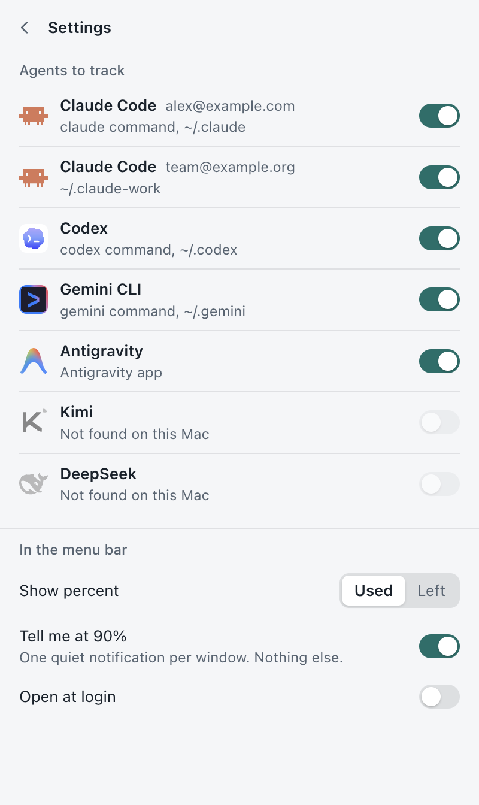

<p align="center">
  
</p>

<h1 align="center">Headroom</h1>

<p align="center">
  How much room is left on every coding agent you use,<br>
  in the menu bar on macOS, the taskbar on Windows and the tray on Linux.
</p>

<p align="center">
  <a href="https://github.com/ishmalazmi/headroom/actions/workflows/ci.yml"></a>
  <a href="LICENSE"></a>
  
</p>

<table align="center">
  <tr>
    <td></td>
    <td></td>
  </tr>
</table>

## Why

Claude Code, Codex, Gemini CLI and the rest each have their own limits, their own reset clocks and their own place to check them. Headroom reads the files those agents already write and puts the answer one glance away: one number in the bar, and everything else one click below it.

## What it does

- **One number in the bar.** Pin one agent and its usage stays visible. Close to the limit, the number turns into the time until it resets.
- **Every agent in one dropdown.** Claude Code, Codex, Gemini CLI, Antigravity, Kimi and DeepSeek. Click a row for detail, or its pin to move it to the bar.
- **Finds your agents by itself.** On first launch it lists what is installed and asks which to track. Agents you install later are offered in the dropdown.
- **More than one Claude login.** If you keep separate Claude logins (for example `~/.claude` and `~/.claude-work`), each appears as its own row with the account it belongs to. Track one or all of them, and pin whichever you like.
- **Pace, not just percent.** On each bar the fill is usage and the tick is time elapsed, so you can see whether you will run out before the window resets.
- **Quiet.** Monochrome until 75%, amber after that, red from 90%. One silent notification at 90%. Nothing else.
- **Local.** No account, no telemetry. See [Privacy](#privacy).

## A closer look

<table>
  <tr>
    <td width="33%"></td>
    <td width="33%"></td>
    <td width="33%"></td>
  </tr>
  <tr>
    <td valign="top"><b>First run.</b> Pick what to track and which agent stays in the bar. That is the whole setup.</td>
    <td valign="top"><b>Any agent in detail.</b> Click a row to see its limits, reset times and tokens. Click its pin to move it to the bar.</td>
    <td valign="top"><b>Settings.</b> Choose agents, show percent used or left, and keep or silence the single 90% notification.</td>
  </tr>
</table>

Screenshots use sample data (`HEADROOM_DEMO=1 npm start`).

## Install

Download the installer for your system from the [latest release](https://github.com/ishmalazmi/headroom/releases/latest):

| Platform | File |
| --- | --- |
| macOS, Apple silicon | `Headroom-*-mac-arm64.dmg` |
| macOS, Intel | `Headroom-*-mac-x64.dmg` |
| Windows | `Headroom-*-win-x64.exe` |
| Linux | `Headroom-*-linux-x86_64.AppImage` or `Headroom-*-linux-amd64.deb` |

The builds are not signed by a registered developer, so your system will warn you the first time:

- **macOS:** open the app once, then go to System Settings → Privacy & Security and choose **Open Anyway**.
- **Windows:** on the SmartScreen prompt choose **More info**, then **Run anyway**.
- **Linux (AppImage):** make the file executable (`chmod +x`), then run it.

On first launch Headroom lists the agents it found and asks which to track. After that it lives in the bar.

### Run from source

With Node 22 or newer:

```bash
git clone https://github.com/ishmalazmi/headroom.git
cd headroom
npm install
npm start
```

`npm run dist` builds an installer for the platform you are on.

## What each agent can show

| Agent | Read from | What you get |
| --- | --- | --- |
| Codex | `~/.codex/sessions` | Exact 5-hour and weekly percentages and reset times, as of your last turn. Tokens. |
| Claude Code | `~/.claude/projects`, and each extra login folder | Tokens and the session reset time. Percentages need **Read limits from Anthropic** (see [Privacy](#privacy)). |
| Gemini CLI | `~/.gemini/tmp/*/chats` | Requests and tokens today, and the daily reset time. No percentage, because the allowance depends on the account. |
| Antigravity | `~/.gemini/antigravity-cli` | Conversations touched, and quota lockouts found in its logs. It keeps no usage meter on disk. |
| Kimi, DeepSeek | their config folders | Token counts picked out of local session logs. Estimates. |

Headroom never invents a percentage. Where an agent publishes no limit, you get counts and a note saying so.

The Gemini CLI, Kimi and DeepSeek readers were written from the file formats those tools are known to use and have had little real-world testing. Windows and Linux builds are also lightly tested. Reports and fixes are very welcome.

## Privacy

Headroom reads local files and sends nothing anywhere, with one opt-in exception.

Claude Code does not store limit percentages on disk. If you turn on **Read limits from Anthropic**, Headroom reads the sign-in Claude Code already saved (the macOS Keychain, or `~/.claude/.credentials.json`) and asks Anthropic's usage endpoint for your percentages every five minutes. The token is used for that one request and is never stored or logged by Headroom. That endpoint is not publicly documented and may change.

To show which account each Claude login belongs to, and to keep a saved sign-in from going stale, Headroom runs Claude Code's own `claude auth status` command. Claude Code renews its sign-in itself; Headroom never writes credentials. The desktop app's sign-in cannot be read by other apps, so percentages need the `claude` command to be signed in for each login you track. When it is not, Headroom shows a **Sign in** button that runs Claude Code's own sign-in for that login in your browser.

Headroom never writes to another tool's files.

## Contributing

Contributions are welcome, especially new agents and fixes to the readers above.

- [CONTRIBUTING.md](CONTRIBUTING.md) covers setup, code layout, the design principles and how to send a change.
- [docs/adding-an-agent.md](docs/adding-an-agent.md) walks through supporting a new agent.
- [SECURITY.md](SECURITY.md) explains how to report a security problem privately.

```bash
npm test        # unit tests, no Electron needed
npm run check   # syntax check
```

## Trademarks

Headroom is an independent project and is not affiliated with, endorsed by or sponsored by Anthropic, OpenAI, Google, Moonshot AI or DeepSeek. Product names and logos belong to their owners and are used only to identify the products. See [THIRD_PARTY_NOTICES.md](THIRD_PARTY_NOTICES.md).

## License

[MIT](LICENSE)
